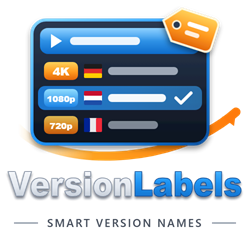

# Jellyfin Plugins by EdwardLecock

A collection of plugins for Jellyfin media server.

This repository started as a fork of [Atilil/jellyfin-plugins](https://github.com/Atilil/jellyfin-plugins). It is now maintained here, with a JellyTag fix for items with multiple versions and the new Version Labels plugin.

## Installation

1. Open Jellyfin and go to **Administration → Dashboard → Plugins → Repositories**
2. Click **Add** and enter:
   - **Name:** `EdwardLecock Plugins`
   - **URL:** `https://raw.githubusercontent.com/EdwardLecock/jellyfin-plugins/main/manifest.json`
3. Click **Save**
4. Go to **Catalog** tab and install the plugins you want
5. Restart Jellyfin

## Available Plugins

### WatchSync

    

Automatically synchronizes watch history between libraries of different qualities (4K/HD). When a movie is watched in 4K, the HD version is also marked as watched (and vice versa).

**Features:**
- Automatic sync on playback stop
- Smart matching via IMDB, TMDB, TVDB
- Support for movies and TV series
- Configurable completion threshold
- Library and user exclusion
- Full sync scheduled task

[More details](WatchSync/README.md)

---

### JellyTag

    

Automatically adds quality resolution badges (4K, 1080p, 720p, SD) to your media posters and thumbnails. Badges are applied server-side via HTTP middleware, visible on all Jellyfin clients without configuration.

**Features:**
- Automatic quality detection from video metadata
- Configurable badge position, size, and margin per image type
- Support for posters, thumbnails, and backdrops
- File-based image caching for performance
- Works on all clients (web, mobile, TV, Kodi)

[More details](Jellytag/README.md)

---

### Version Labels

    

Adds quality and audio language information to the names in Jellyfin's version selector, so switching between versions is easier. For example `EN-NL` becomes `EN-NL · 1080p · English, Dutch`. Works in every Jellyfin app.

**Features:**
- Configurable label template with placeholders (resolution, HDR, codecs, audio languages, subtitles, size)
- Presets and a live preview on the settings page
- Nothing is renamed on disk or in the database

[More details](VersionLabels/README.md)

---

### Requirements

- Jellyfin 10.11.0 or higher
- .NET 9 SDK (for building)

## License

MIT License - see [LICENSE](LICENSE) file.

## Author

**EdwardLecock**

### Credits

WatchSync and JellyTag were originally created by **Atilili** in [Atilil/jellyfin-plugins](https://github.com/Atilil/jellyfin-plugins).

---

## Disclaimer

This project was developed with the assistance of AI (Claude by Anthropic).
